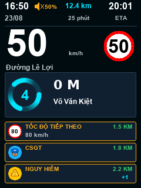
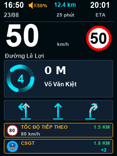
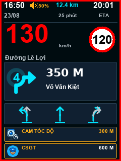

# Firmware portrait v2 — 2026-11-07

Phiên bản `2.8.15-portrait.2`, board ES3C28P ESP32-S3. Đây là ảnh dựng từ **renderer C++ thực tế**, không phải ảnh concept:

| Bùng binh + tốc độ tiếp theo | Làn đường + nhiều cảnh báo | Tốc độ 3 chữ số |
| --- | --- | --- |
|  |  |  |

## File nạp

- Factory: `waze-hud/dist/waze_hud_es3c28p_portrait_v2_factory_20261107.bin`, nạp tại `0x0`.
- App: `waze-hud/dist/waze_hud_es3c28p_portrait_v2_app_20261107.bin`, dùng khi cập nhật app/OTA, không nạp ở `0x0`.
- Hash và thông tin kiểm chứng ở `verification.json`. Binary nằm local, được `.gitignore` bỏ qua theo cấu trúc repo hiện tại.
- File factory có thể ghi đè cấu hình NVS. Khi nâng cấp giữ NVS, hãy tắt phản chiếu nếu từng bật để chữa chữ ngược ở chế độ dọc.
- Loa HUD mặc định tắt. Bật `Canh bao qua loa HUD` trong app để nghe box; tắt tiếng Waze trên điện thoại nếu chỉ muốn phát một nguồn. Mức âm lượng vẫn điều chỉnh qua app hoặc vuốt, 0% im lặng.

## Kiểm chứng

- ESP-IDF 5.5.5, `sdkconfig.es3c28p`, `sdkconfig.es3c28p.defaults`, `dependencies.es3c28p.lock`; build riêng trong `/private/tmp/WazeHud-build-portrait-20261107`.
- Host renderer ASan/UBSan: 21 loại hướng rẽ, 75 loại cảnh báo; chạm đồng hồ khi lượt rẽ 0 m vẫn giữ đồng hồ sau 6 giây, lượt rẽ khẩn mới trả về HUD; giữ xem thống kê, vuốt xuống 0, đổi ngang/dọc.
- 614400 phép đổi tọa độ qua các hướng; kiểm tra tọa độ tuyệt đối cho bù trục ngang ở chế độ dọc.
- 458752 phép kiểm tra PCM: toàn dải signed 16-bit với 7 mức gain; các trường hợp sự kiện cũ/mới trong chính sách tự về HUD.
- Schema 12 mục, nâng từ v7/v8 lên v9 giữ cấu hình, lưu volume/loa/dọc, dữ liệu sai, cập nhật đồng thời và lỗi NVS.
- Chưa kiểm chứng trên box: chiều chữ thực tế, thao tác cảm ứng, độ lớn/độ rè loa, giao diện và lưu cấu hình qua WazeMod BLE.

Chạy renderer và kiểm tra gesture/PCM:

```sh
rtk sh tools/host_preview/run.sh
```

Tạo lại glyph native và mask làn khi cần (Pillow 13, font Arial Bold trên macOS):

```sh
rtk python3 tools/generate_portrait_assets.py --font '/System/Library/Fonts/Supplemental/Arial Bold.ttf'
```

Các asset C++ đã được lưu trong source, build firmware thông thường không cần Pillow hoặc file font.
