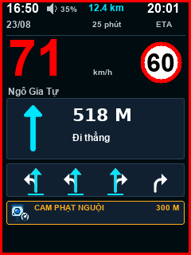

# Portrait v3 — lane, audio and camera fixes

Mốc firmware `2.8.15-portrait.3`, ESP32-S3 ES3C28P, 2026-11-07; lưu lại kết quả trước bản `.4`.



## Đối chiếu âm thanh với mốc fork

So sánh `waze-hud/main/audio/overspeed_audio.cpp` ở `3d4530f` và bản hiện tại:

| Mục | Bản fork | Bản mới |
| --- | --- | --- |
| Amp | GPIO1, active-low | Giữ nguyên |
| I2S | MCLK4, BCLK5, WS7, DOUT8 | Giữ nguyên |
| Dữ liệu | 16 kHz, signed 16-bit, stereo lặp mono | Giữ nguyên |
| MCLK / I2C | 16000×256; SDA16/SCL15, 100 kHz, codec 0x18/0x19 | Giữ nguyên; bus dùng chung với cảm ứng |
| Điều kiện | Quá tốc liên tục 1,5 s, dữ liệu còn mới; lặp 4 s sau khi đọc xong | Giữ nguyên; 0% tắt tiếng |
| Gain | Cố định theo build (49%), codec 90 | Runtime 0–100%, giữ headroom 0,85 và codec 75 của `.2`; phép nhân PCM có dấu |
| Tắt tiếng | Không có điều chỉnh runtime | Chỉ bằng âm lượng 0%; bỏ công tắc phụ của `.2` |

Nguyên nhân im lặng xác định trong `.2`: `hudAudioEnabled=false` được lưu mặc định; `isOverspeed`, `playAlert` và `writeFrames` đều chặn dù `volume=35`. Bản `.3` bỏ công tắc này, đồng thời bỏ mục app và bỏ qua khóa NVS `hud_audio` khi nâng cấp. Schema 11 mục/v10 giữ mức âm lượng, hướng màn hình và các cài đặt khác; 0% đã chọn vẫn được giữ. Vuốt tăng âm lượng sau khi tắt giữa một clip bật lại amp ngay ở chunk kế tiếp.

Task audio chỉ phát cảnh báo quá tốc độ, giống mốc fork; không phát lại toàn bộ giọng dẫn đường/cảnh báo camera của điện thoại. Firmware không điều khiển tiếng Waze trên điện thoại.

## Làn đường và camera

- Đầu mũi tên đặc; nhánh rẽ ngang thấp hơn đầu đi thẳng, tránh dính thành một cụm. Hợp các mask trước khi vẽ để nhánh không chọn không đè lên hướng được chọn. Hướng được chọn xanh, nhánh khác trắng; giữ chỉ báo làn được chọn và các làn bị ẩn.
- Phân biệt 8 bit hướng (thẳng, chếch trái, trái, trái gắt, chếch phải, phải, phải gắt, quay đầu), giữ nguyên dữ liệu điện thoại gửi.
- Tài liệu repo `waze-hud-link-sdk-ai-bundle.md`, bảng enum cảnh báo: `CAMERA_PHONE = 40` có nghĩa “Camera phạt nguội”. Sửa nhãn từ “CAM ĐIỆN THOẠI” thành “CAM PHẠT NGUỘI”, dùng icon camera. Giữ wire code 40 và loại riêng cho camera tốc độ (2), đèn đỏ (3), dây an toàn (42).

## Build và kiểm chứng

- Factory: `waze-hud/dist/waze_hud_es3c28p_portrait_v3_factory_20261107.bin`, nạp ở `0x0`; có thể đặt lại cấu hình NVS.
- App: `waze-hud/dist/waze_hud_es3c28p_portrait_v3_app_20261107.bin`, dùng OTA; không nạp ở `0x0`.
- Hash, kích thước và kiểm tra trong `verification.json`.
- ESP-IDF 5.5.5, profile BLE ES3C28P. Build riêng, khôi phục lockfile sau build. Còn 34% phân vùng app.
- Host renderer ASan/UBSan, 21 hướng rẽ và 75 loại cảnh báo; 614400 ánh xạ; 458752 kiểm tra signed PCM; chính sách đổi trang; task audio thực với I2S/GPIO giả lập ở 35%, 0%, bật/tắt giữa clip, dữ liệu cũ và dưới giới hạn; decoder camera 40 và 4 làn; schema v7/v8/v9 → v10 kể cả trường hợp volume35 + hud_audio0 và volume0.
- Chưa kiểm chứng: loa/codec thật, cấu hình qua BLE/app và độ dễ nhìn trên box ngoài trời.

```sh
rtk sh tools/host_preview/run.sh
rtk env IDF_PATH=/private/tmp/wazehud-idf-5.5.5 sh tests/run_config_protocol.sh
```
