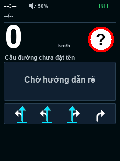

# Portrait.4 — lời đọc tiếng Việt và kiểm tra làn

ESP32-S3 ES3C28P BLE, `2.8.15-portrait.4`, 2026-11-07. Người dùng đã nạp thử và xác nhận làn đường hiển thị.

## Âm thanh

Bản fork `3d4530f` và `.3` chỉ nhúng câu “Bạn đã quá tốc độ”. HLP/1 gửi dữ liệu hướng rẽ/biển báo, không gửi âm thanh Waze. `.4` thêm 52 đoạn giọng Linh tiếng Việt offline, G.711 mu-law 8 kHz, tổng 432872 byte; giải mã và đưa ra I2S 16 kHz như cũ.

- Chuẩn bị hướng rẽ trong 500 m; nhắc thực hiện trong 80 m; vòng xuyến và số lối ra. Đến nơi chỉ đọc gần điểm đến.
- Giới hạn hiện tại khi có dữ liệu lần đầu hoặc thay đổi; giới hạn tiếp theo trong 1000 m. Số 0–999 được ghép theo tiếng Việt, không suy ra “hạ tốc” nếu giới hạn tiếp theo cao hơn hiện tại.
- Camera phạt nguội, tốc độ và đèn đỏ trong 600 m; các loại camera khác dùng lời camera giao thông.
- CSGT, nguy hiểm, tai nạn, đóng đường, đường sắt, công trường, gờ giảm tốc, trường học, đèn giao thông, ùn tắc trong 300 m; vùng cấm vượt khi đang ở trong vùng; các biển còn lại dùng lời nhắc chung.
- Một lần cho mỗi giai đoạn/sự kiện. Chỉ ghi nhận đã đọc khi hoàn tất. Rẽ và cảnh báo sát được ưu tiên; bỏ lời đọc khi đổi phiên, ngắt kết nối, dữ liệu cũ, sự kiện không còn hoặc âm lượng 0%. Không giữ hàng đợi câu rẽ đã cũ.
- Quá tốc giữ debounce 1,5 giây, nhắc lại theo cấu hình (mặc định 4 giây sau khi đọc xong). Tăng stack task audio lên 8192 byte cho đường phát mới.
- Không đọc tên đường hoặc chuyển tiếp giọng Waze trên điện thoại. Tắt âm thanh Waze trên điện thoại nếu chỉ muốn nghe một nguồn.

Các file WAV dưới đây dùng chính dữ liệu nhúng, giải mã và mức âm lượng 35% của firmware:

- [Chuẩn bị rẽ phải](prepare-right.wav)
- [Giới hạn hiện tại 80](current-limit-80.wav)
- [Giới hạn tiếp theo 50](next-limit-50.wav)
- [Camera phạt nguội](camera-enforcement.wav)

Tạo lại asset cần macOS có giọng Linh và FFmpeg; build firmware thông thường không cần hai công cụ này:

```sh
rtk python3 tools/generate_speech_bank.py
```

## Làn đường: điều đã chứng minh và điều chưa biết

Người dùng xác nhận cả khung làn mất. Đường vẽ `.3` vẫn hiển thị đúng khi bơm state hợp lệ; decoder/parser lane và declaration opt-in `lan` không bị thay đổi về ý nghĩa trong lần sửa icon `.3`. Declaration hiện dài dưới 512 byte. Console thật cho thấy Waze 5.24.5.0 nhận handshake và tiếp tục gửi state; bản cũ không ghi raw `lan`, nên chưa chứng minh được nguyên nhân trên box.

`.4` sửa các trường hợp gây mất khung tái hiện bằng kiểm thử:

1. Có làn nhưng `nav=0`: vẫn hiện làn từ dữ liệu nhận được; không tự suy ra thông tin ETA/dẫn đường.
2. `nav=true` thay vì `nav=1`: đọc đúng cả hai.
3. Hướng hợp lệ nhưng mask chọn không thuộc hướng: giữ nguyên vị trí/hướng, bỏ tô xanh cho phần chọn lỗi. Không đoán làn cần đi.
4. Đổi session: xóa cache lane cũ. `lan:[]` xóa làn ngay theo giao thức. Khi field bị thiếu, giữ cơ chế lưu tạm có giới hạn như trước.

Ảnh từ JSON qua decoder thật rồi renderer chia dải 40 hàng, với `nav=0` nhưng 4 làn hợp lệ:



Log mới chỉ chứa trạng thái trường và số lượng, không in tên đường:

```text
HLP: Negotiated lan=yes
HLP: LAN wire=4 accepted=4 visible=4 nav=1 badSelection=0 (-1=missing,-2=malformed)
```

- `wire=-1`: app không gửi trường `lan` trong frame đó; `0`: app gửi mảng rỗng; `-2`: sai kiểu.
- `accepted`: số làn decoder chấp nhận; `visible`: số làn sau xử lý cache.
- `badSelection=1`: có lựa chọn sai, HUD giữ hướng và không đoán màu chọn.
- Trang trạng thái thiết bị có dòng số làn nhận/hiện. Nếu vẫn mất, cần log mới trong đúng lúc Waze hiện lane; không dựng làn giả từ một mũi tên rẽ.

### Kết quả thử trên box

Ngày 2026-11-07, người dùng xác nhận làn đường đã hiện sau bước ngắt/kết nối lại HUD Link. Log đọc trước đó có `LAN wire=-1 accepted=0 visible=0 nav=1`: thiếu trường `lan` trong phiên đó, không phải decoder loại icon hợp lệ. Console USB sau đó bị ngắt nên chưa lưu được log thương lượng của phiên khôi phục; nguyên nhân gốc khiến app bỏ trường `lan` chưa được chứng minh. Bản `.3` cũng đã được người dùng xác nhận loa phát cảnh báo quá tốc độ.

## File và kiểm chứng

- Factory `waze-hud/dist/waze_hud_es3c28p_portrait_v4_factory_20261107.bin`: nạp `0x0`, có thể đặt lại NVS/cấu hình.
- App `waze-hud/dist/waze_hud_es3c28p_portrait_v4_app_20261107.bin`: offset app `0x20000` khi công cụ hỗ trợ nạp riêng. WiFi OTA trong bản S3 này vẫn tắt.
- SHA-256/kích thước/checks trong `verification.json`. Giữ nguyên các file build `.1/.2/.3` để quay lại khi cần.
- Build ESP-IDF 5.5.5/profile S3 BLE; còn khoảng 20% phân vùng app 3 MiB.
- ASan/UBSan: renderer, các góc đổi trang, cử chỉ, ánh xạ; task audio thực với I2S/GPIO giả; bộ chọn lời đọc, ưu tiên/hủy và tránh lặp; JSON → lane renderer; cấu hình/camera. Mọi mã mu-law được so sánh với FFmpeg (256/256), mọi clip nhúng có tín hiệu.
- Đã có xác nhận làn hiện trên box; vẫn cần kiểm chứng đầy đủ các lời đọc mới qua loa thật, tuyến đường thực tế và cấu hình BLE/app. Chưa có raw log của phiên khôi phục làn.

```sh
rtk sh tools/host_preview/run.sh
rtk env IDF_PATH=/private/tmp/wazehud-idf-5.5.5 sh tests/run_config_protocol.sh
rtk sh tests/run_speech_bank_test.sh
```
